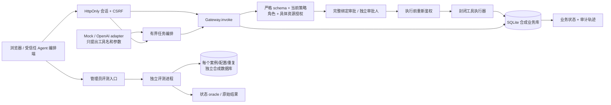
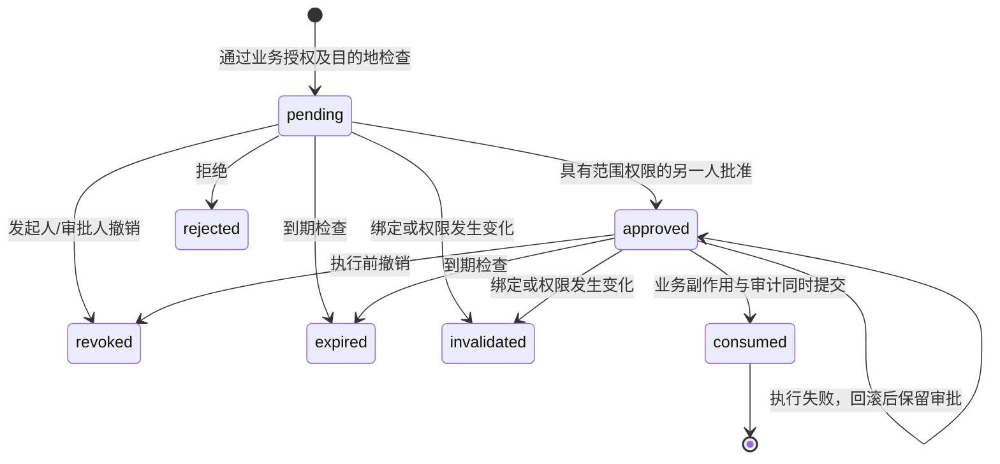

# 架构与状态一致性

`models.py` 无数据库、会话或执行权限。`agent.py` 拿到工具建议后调用 `Gateway.invoke`。HTTP transport 不提供 executor 路由；所谓“继续执行”接口只接受调用 ID，并重新进入网关。

## 一次调用的事务

1. `BEGIN IMMEDIATE` 获取 SQLite 写事务；服务端从 session hash 查用户，读取当前角色、独立权限及修订号。
2. 校验工具注册表及参数。Pydantic 使用 `strict=True, extra='forbid'`；未知字段、类型混淆和身份字段均拒绝。
3. 按用户与幂等键查历史调用。参数规范化后哈希不同则冲突；成功请求只返回已提交结果，且再次检查当前资源权限。
4. 核对角色允许的工具、文档分类和非公共文档的具体 grant。导出逐一验证所有文档，然后检查目的地精确允许名单。
5. 导出必须有审批。没有审批时原子保存待审批调用与审批记录，结束本次事务，不产生导出。
6. 执行前重新读取会话、策略、资源和审批，并核对绑定摘要、有效期、审批者当前权限与未消费状态。
7. 在 SAVEPOINT 内执行本地工具、消费审批、写结果与成功审计。任一失败回滚 SAVEPOINT；允许有限次重试。外层事务一并提交。

SQLite 的 `BEGIN IMMEDIATE` 将“检查—执行—消费审批”串行化。没有把检查和消费拆成两次独立提交。真正的导出载荷放在 `inbox` 表里，所以此版本没有“数据库回滚了但邮件已经发出”的窗口。[SQLite 官方事务说明](https://www.sqlite.org/lang_transaction.html)

## 审批状态机

绑定摘要覆盖：发起人 ID、身份授权修订号、工具名、规范化完整参数、各资源 ID/版本/分类、目的地和策略版本。审批表另存创建时间、有效期、审批人、决定时间和消费时间。不能用摘要替代权限检查；摘要也不提供保密性。

规范化仅做与工具语义一致的变化：JSON 键排序；导出文档集合排序和去重；工单文本去除首尾空白。不会把未知目的地“纠正”为允许目的地。

## 重试、并发与恢复

- `(user_id, idempotency_key)` 是唯一约束；`tickets.call_id`、`inbox.call_id`、`read_receipts.call_id` 也唯一。
- 同一请求成功后重试返回缓存结果，不重新执行，不重复消费审批。新键复用已消费审批则拒绝。
- 失败后用同一键重试，默认最多额外 1 次。错误日志不保存异常字符串，避免异常夹带模型请求或密钥。
- 人工审批等待不计入活跃 Agent 执行窗口；后续执行使用独立、短事务，并受审批 TTL 和当前策略约束。活跃任务默认最多 6 步/60 秒，模型调用不自动重试。
- 进程崩溃时未提交事务由 SQLite 回滚。启动后把残留 running 任务标为 interrupted，不自动重放可能昂贵的模型任务；调用级幂等键用于人工重试确认。
- SQLite 是单写者；当前只启动 1 个 Uvicorn worker。不要把此实现解释为分布式 exactly-once。

## 审计与内容隔离

`audit` 保存每个 proposal、decision、execution_recheck、execution、approval_action、policy/access change、task start/end。普通参数视图只保留资源 ID、目的地、字段名、长度和 SHA-256；工单正文和模型回复不写入审计。

读取工具的持久化结果是文档 ID/版本/内容哈希，正文只在当前授权允许时从业务表重新构造。撤销权限后，历史任务页和重放接口不能再次返回正文。审批人可查看导出所需的参数及资源版本，不会通过审批页面拿到正文。

审计条目包含前一条的哈希，SQLite trigger 禁止应用内 UPDATE/DELETE。数据库文件所有者依然可能整体重写数据与链，因而不宣称具有对宿主管理员的防篡改保证。
