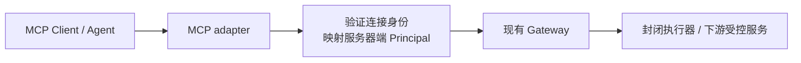

# 后续 MCP 接入设计（v0.1 未实现）

当前可复用入口是 HTTP `POST /api/gateway/call` 和可信后端的 `Gateway.invoke`。MCP 扩展应复用这个入口，不另写第二套授权判断。

1. MCP 工具列表只暴露 read_document、create_ticket、export_report 的业务参数；工具描述、模型参数或 MCP 资源不能包含可生效的 role/user_id。
2. Streamable HTTP 接入时，必须验证 audience/issuer 的 OAuth token 或部署内等价机制，映射服务器端身份。不能信任任意客户端提供的 user header。stdio 模式也需明确定义启动进程对应的用户边界。
3. 导出返回 pending_approval 与 call/approval ID。审批仍走独立的人类 UI / 受保护 API，不把“approve”作为模型可调用工具。
4. request_id 映射为用户范围的幂等键；重连或重试重新鉴权。工具参数 schema、canonicalization 和策略版本与 HTTP 入口共用。
5. 工具结果的结构化错误应包含 reason code 和可展示信息，不含 session、服务凭据或正文调试日志。不可信 tool description 和 resource 内容也只是数据。
6. 下游真实服务从网关获取短期、单次、参数绑定的执行授权，而不是接受模型提交的“已批准”字段。
7. 对真实邮件/存储导出，增加 transactional outbox；使用唯一 operation ID 调用下游幂等接口；区分 queued、delivering、delivered、failed、unknown，使用对账处理网络超时后的未知状态。
8. 增加 MCP 协议一致性、token audience、重连重放、越权 resource URI、跨连接混淆和独立进程网络/文件访问测试。

多租户需要把 tenant_id 放在服务端身份、每张业务表、幂等唯一键、审批绑定和审计过滤中；不能只是给请求多加一个可由模型任意填写的字段。更多模型只扩展 adapter，不能让其拥有更大的执行权限。
